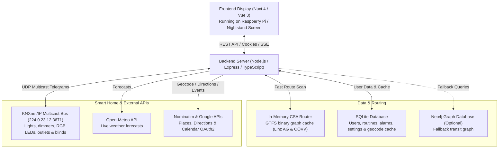

# SmartHub

SmartHub is a smart morning dashboard and room controller built for a wall-mounted LCD screen above a nightstand, powered by a Raspberry Pi.

It helps you get ready in the morning by showing you exactly what you need before walking out the door—upcoming bus connections, driving time, local weather, and calendar events—while providing direct KNX smart-home control for room lighting, outlets, and window blinds.

<p align="center">
  
</p>

<p align="center">
  
  
  
  
  
  
  
  
</p>

---

## What It Does

When you wake up, you don't want to open five different apps to check the weather, alarms, transit connections, and room controls. SmartHub puts everything onto a single dedicated screen that adapts automatically to your schedule.

- **Automatic widget switching**: On weekday mornings, it displays your bus route or car travel time to work or school based on your active routine. Outside of commute windows, it shows a clock, weather, upcoming calendar appointments, and daily motivation.
- **In-memory public transit routing (CSA)**: Computes multi-stop transit routes across official Austrian public transport schedules (Linz AG & OÖVV GTFS datasets) in milliseconds using the Connection Scan Algorithm (`csa-router.ts`), backed by a fast binary graph cache (`csa-graph-cache.bin`) and optional Neo4j fallback.
- **KNX smart room control & hardware OSD**: Connects to the local KNXnet/IP multicast bus (`224.0.23.12:3671`) to control ceiling lights, dimmable desk lights, RGB LED strips, power outlets, and window blinds/slats via a unified hardware-style On-Screen Display (`device-osd-overlay.vue`) with real-time Server-Sent Events (SSE) state synchronization.
- **Live weather & destination forecast**: Fetches 2-hour interval forecasts via Open-Meteo for both your home and routine destination so you know whether you need an umbrella.
- **Google Calendar integration**: OAuth2 integration showing your upcoming daily appointments directly on the dashboard.
- **Weekly routine & alarm planner**: Configure per-day routines (e.g., Monday–Thursday 07:15 bus commute; Friday 08:00 car commute) with persistent SQLite storage and geocoding cache.

---

## How It Works



---

## Tech Stack & Architecture

- **Frontend**: Nuxt 4 (`ssr: false`), Vue 3, TypeScript, Tailwind CSS.
  - Modular dashboard widgets: `bus-widget`, `car-widget`, `weather-widget`, `clock-widget`, `appointments-widget`, `motivation-widget`.
  - Hardware-style `device-osd-overlay` with keyboard/button navigation and live SSE updates.
- **Backend**: Node.js, Express, TypeScript (`tsx`).
  - Clean router/service/repository separation (`_backend/src/routers`, `_backend/src/services`, `_backend/src/repo`).
  - Session authentication with HTTP-only cookies and `bcryptjs`.
- **Custom Transit Engine (CSA)**:
  - Located in `_backend/src/repo/csa-router.ts`.
  - Parses Linz AG & OÖVV GTFS archives directly into compact TypedArrays and caches the binary graph in `data/csa-graph-cache.bin` for sub-second startup and millisecond forward/reverse route scans.
- **Smart Home Integration (KNX)**:
  - Located in `_backend/src/services/knx-service.ts`, `_backend/src/services/device-service.ts`, and `_backend/src/repo/knx-repo.ts`.
  - Communicates via `knxultimate` over UDP multicast and streams live group-address state updates to connected clients via `/api/devices/events`.
- **Databases**:
  - **SQLite (`better-sqlite3`)**: Stores user accounts, preferences, routines, alarms, OAuth tokens, and cached geocoding lookups.
  - **Neo4j 5 (Optional `--profile neo4j`)**: Graph database for GTFS exploration and fallback routing.

---

## Getting Started

### Option 1: Run with Docker (Recommended)

1. Clone the repository and enter the directory:
   ```bash
   git clone https://github.com/2526-wmc-3bhif-classroom-org/sommerprojekt-wmc-hungry-team.git
   cd smarthub
   ```

2. Copy the example environment file and configure your keys:
   ```bash
   cp .env.example .env
   ```

3. Start the backend and frontend containers:
   ```bash
   docker compose up -d
   ```
   *(Optional: To also start Neo4j and the GTFS graph loader, run `docker compose --profile neo4j up -d`.)*

4. Open the apps in your browser:
   - **Frontend Dashboard**: [http://localhost:3001](http://localhost:3001)
   - **Backend API**: [http://localhost:3000](http://localhost:3000)

---

### Option 2: Run Locally (Without Docker)

#### Prerequisites
- Node.js 20+

#### 1. Start the Backend
```bash
cd _backend
npm install
npm run dev
```
API runs on `http://localhost:3000`. On first run, the CSA router automatically builds the transit graph cache from `data/*.zip`.

#### 2. Start the Frontend
```bash
cd _frontend/smarthub
npm install
NUXT_PUBLIC_API_BASE_URL=http://localhost:3000 npm run dev
```
Dashboard runs on `http://localhost:3000` (or `3001` via Docker).

---

## Configuration (`.env`)

| Variable | Description |
|---|---|
| `DB_PATH` | Path to SQLite file (default: `/data/smarthub.sqlite`) |
| `SESSION_COOKIE_NAME` | Name of the authentication cookie (default: `smarthub_session`) |
| `SESSION_MAX_AGE_DAYS` | Session lifetime in days (default: `3650`) |
| `COOKIE_SECURE` | Set `true` when serving over HTTPS (`false` for LAN HTTP) |
| `GOOGLE_KEY` | Google API key for driving directions and fallback geocoding |
| `GOOGLE_OAUTH_CLIENT_ID` | Google OAuth2 Client ID for Calendar integration |
| `GOOGLE_OAUTH_CLIENT_SECRET` | Google OAuth2 Client Secret |
| `GOOGLE_OAUTH_REDIRECT_URI` | OAuth callback URL (`http://localhost:3000/api/auth/google/callback`) |
| `FRONTEND_BASE_URL` | Frontend URL for OAuth redirects (`http://localhost:3001`) |
| `NUXT_PUBLIC_API_BASE_URL` | Backend base URL used by the Nuxt frontend |
| `ALLOWED_ORIGINS` | Comma-separated list of additional allowed CORS origins |
| `KNX_ENABLED` | Enable KNXnet/IP multicast integration (`true` / `false`) |
| `KNX_MULTICAST_IP` | KNX routing multicast address (default: `224.0.23.12`) |
| `KNX_PORT` | KNX UDP port (default: `3671`) |
| `KNX_PHYS_ADDR` | Physical KNX address assigned to SmartHub (default: `1.2.6`) |
| `KNX_INTERFACE` | Optional local network interface IP/name for KNX multicast |
| `NEO4J_USER` / `NEO4J_PASSWORD` | Credentials for optional Neo4j container |
| `NEO4J_HOST` / `NEO4J_BOLT_PORT` | Neo4j host and Bolt port (default: `7687`) |

---

## Project Structure

```text
smarthub/
├── _backend/                  # Express REST API (TypeScript)
│   ├── src/
│   │   ├── db/                # SQLite connection & schema migrations
│   │   ├── middleware/        # Authentication & session checks
│   │   ├── repo/              # CSA transit router, KNX registry, SQLite & Neo4j repos
│   │   ├── routers/           # Bus, weather, places, routines, auth, settings & devices routes
│   │   ├── services/          # KNX multicast client & unified smart device service
│   │   ├── utils/             # Request validation & HTTP helpers
│   │   └── app.ts             # Express server entrypoint
│   ├── test.http              # REST client test requests
│   └── package.json
├── _frontend/smarthub/        # Nuxt 4 frontend application
│   ├── app/
│   │   ├── assets/css/        # Global theme & styling
│   │   ├── components/        # Dashboard widgets & hardware OSD overlay
│   │   ├── composables/       # Reactive state (API client, settings, device OSD)
│   │   ├── layouts/           # Default and landing layouts
│   │   ├── middleware/        # Route authentication guards
│   │   ├── pages/             # Dashboard, settings, and login views
│   │   └── types/             # TypeScript interfaces
│   └── package.json
├── data/                      # GTFS schedule archives (Linz AG & OÖVV) & binary CSA cache
├── docs/                      # Architecture diagrams, KNX ETS export (.esf), and mockups
├── openspec/                  # OpenSpec feature specifications and change archive
├── scripts/                   # Optional Neo4j GTFS import script
├── docker-compose.yaml        # Production/standard multi-container Docker setup
├── docker-compose.dev.yaml    # Development Docker override with live reload
├── showcase.gif               # Animated preview of the dashboard
└── README.md
```

---

## Team

- **Arthur Dirnberger**
- **Matthias Darabosch**
- **Benjamin Stoica**
- **Almir Hadzic**

School project built at **HTL Leonding**.
