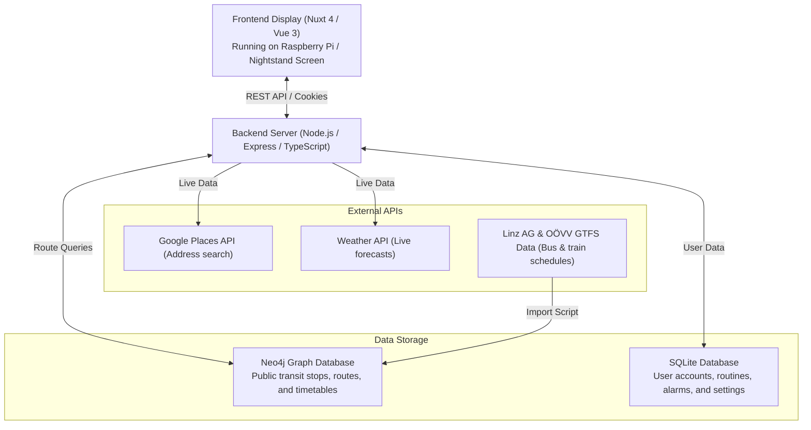

# SmartHub

SmartHub is a smart morning dashboard built for a wall-mounted LCD screen above a nightstand, powered by a Raspberry Pi. 

It helps you get ready in the morning by showing you exactly what you need before walking out the door: your upcoming bus connections, driving time, local weather, and calendar events.

<p align="center">
  
</p>

<p align="center">
  
  
  
  
  
  
  
</p>

---

## What It Does

When you wake up, you don't want to open five different apps to check the weather, alarms, and transit delays. SmartHub puts everything onto a single dedicated morning screen that changes automatically based on your schedule.

- **Automatic widget switching**: On Monday at 7:30 AM, it shows your bus route to work or school. If your routine is set to drive, it switches to car travel times. Outside of commute windows, it shows a clock, weather, and daily motivation.
- **Offline public transit routing**: Instead of querying third-party rate-limited transit APIs, SmartHub runs its own transit routing engine. It imports official Austrian public transport schedules (Linz AG and OÖVV GTFS data) into Neo4j and computes fast multi-stop routes using the Connection Scan Algorithm (CSA).
- **Live weather & destination forecast**: Shows current local temperature, conditions, and the forecast for your final destination so you know if you need an umbrella.
- **Weekly routine & alarm planner**: Set up specific routines per day (e.g. Monday-Thursday 07:15 departure by bus to school; Friday 08:00 departure by car).
- **User accounts & settings**: Secure login with password hashing. Each user stores their home stop, destination addresses, and alarm schedule in SQLite.

---

## How It Works



---

## Tech Stack & Architecture

- **Frontend**: Nuxt 4, Vue 3, TypeScript, Tailwind CSS, Nuxt UI.
  - Built with reusable cards (`bus-widget`, `car-widget`, `weather-widget`, `clock-widget`).
  - Automatically updates every 10 seconds to check whether the current time matches an active routine.
- **Backend**: Node.js, Express, TypeScript (`tsx`).
  - Clean repository pattern separating route handlers from database logic.
  - Session authentication with secure HTTP-only cookies and `bcryptjs`.
- **Custom Transit Engine (CSA)**:
  - Located in `_backend/src/repo/csa-router.ts`.
  - Loads transit network stops and timetable connections directly into memory.
  - Calculates earliest arrival times, transfers, and walking legs in milliseconds.
- **Databases**:
  - **Neo4j 5**: Stores transit network graph data (stops, trips, transfer connections).
  - **SQLite (`better-sqlite3`)**: Stores user accounts, preferences, routines, and alarms.
- **DevOps**:
  - Docker Compose orchestrating Neo4j, backend, frontend, and an automated data loader container that unzips GTFS files and loads them on first launch.

---

## Getting Started

### Option 1: Run with Docker (Easiest)

1. Clone the repository and enter the directory:
   ```bash
   git clone https://github.com/2526-wmc-3bhif-classroom-org/sommerprojekt-wmc-hungry-team.git
   cd smarthub
   ```

2. Copy the example environment file:
   ```bash
   cp .env.example .env
   ```
   *Open `.env` and set a password for `NEO4J_PASSWORD`.*

3. Start all services:
   ```bash
   docker compose up -d
   ```
   *On first launch, the `neo4j-loader` container will automatically unzip the GTFS files in `/data` and populate Neo4j.*

4. Open the apps in your browser:
   - **Frontend Dashboard**: [http://localhost:3001](http://localhost:3001)
   - **Backend API**: [http://localhost:3000](http://localhost:3000)
   - **Neo4j Database Browser**: [http://localhost:7474](http://localhost:7474)

---

### Option 2: Run Locally (Without Docker)

#### Prerequisites
- Node.js 20+
- A running Neo4j instance with GTFS data imported

#### 1. Start the Backend
```bash
cd _backend
npm install
npm run dev
```
API runs on `http://localhost:3000`.

#### 2. Start the Frontend
```bash
cd _frontend/smarthub
npm install
NUXT_PUBLIC_API_BASE_URL=http://localhost:3000 npm run dev
```
Dashboard runs on `http://localhost:3001`.

---

## Configuration (`.env`)

| Variable | Description |
|---|---|
| `NEO4J_USER` | Username for Neo4j database (default: `neo4j`) |
| `NEO4J_PASSWORD` | Password for Neo4j database |
| `NEO4J_HOST` | Hostname for Neo4j (`neo4j` in Docker, `localhost` for local dev) |
| `GOOGLE_KEY` | Optional Google Places API key for address autocomplete |
| `DB_PATH` | Path to SQLite file (default: `/data/smarthub.sqlite`) |
| `SESSION_COOKIE_NAME` | Name of the authentication cookie |
| `NUXT_PUBLIC_API_BASE_URL` | URL the frontend uses to call the backend |

---

## Project Structure

```text
smarthub/
├── _backend/                  # Express REST API (TypeScript)
│   ├── src/
│   │   ├── db/                # SQLite connection & schema migrations
│   │   ├── middleware/        # Authentication & session checks
│   │   ├── repo/              # CSA routing engine & Neo4j database queries
│   │   ├── routers/           # Bus, weather, routine, auth, settings routes
│   │   └── app.ts             # Express server setup
│   └── package.json
├── _frontend/smarthub/        # Nuxt 4 frontend app
│   ├── app/
│   │   ├── components/        # Widgets: bus, car, clock, weather, alarms
│   │   ├── composables/       # Reactive state (routines, user session)
│   │   ├── pages/             # Dashboard, settings, and login pages
│   │   └── middleware/        # Protected page navigation guards
│   └── package.json
├── data/                      # GTFS transit schedule archives (Linz AG & OÖVV)
├── scripts/                   # Automated Neo4j data import script
├── docker-compose.yaml        # Multi-container Docker configuration
├── showcase.gif               # Animated preview of the dashboard
└── README.md
```

---

## Team

- **Arthur Dirnberger**
- **Matthias Darabosch**
- **Benjamin Stoica**
- **Almir Hadzic**

School project built at **HTL Leonding**.
